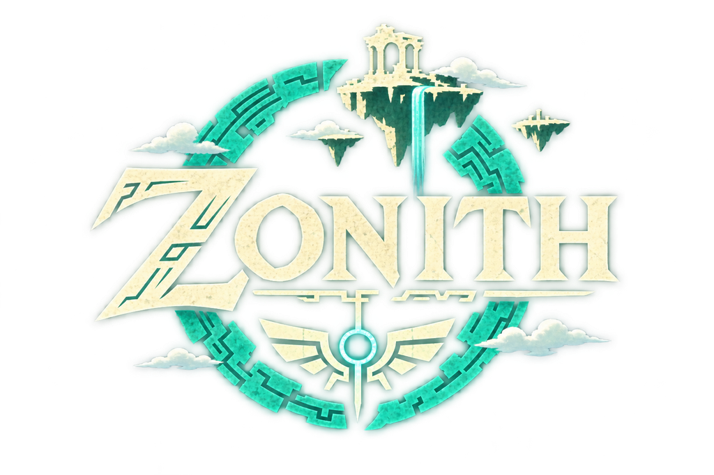

<h1 align="center">
  
</h1>

  <b>A static recompilation of <i>The Legend of Zelda: Tears of the Kingdom</i> (Nintendo Switch, 2023) into a native x86-64 game for Windows and Linux. Native code, not emulation.</b>

  
  
  
  
  
  

  
  

  <b><a href="../../releases">Releases</a></b> ·
  <a href="#installing">Installing</a> ·
  <a href="docs/controls.md">Controls</a> ·
  <a href="docs/mods.md">Mods</a> ·
  <a href="CONTRIBUTING.md">Contributing</a> ·
  <a href="#credits">Credits</a> ·
  <a href="THIRD_PARTY_NOTICES.md">Third-party notices</a> ·
  <a href="../../issues">Issues</a>

> [!IMPORTANT]
> **No game files are included.** You need your own legally obtained copy of *Tears of the Kingdom*, dumped from your own console: the base game and the 1.1.0, 1.2.1 or 1.4.3 update. Instructions for obtaining those files will not be provided.
>
> The game is built from your files on your machine, so the result contains the game. It is for your own use. Do not share it.

> [!NOTE]
> **Built with AI, supervised by humans.** Most of the code and documentation is written by AI coding agents under the maintainers' direction. The maintainers play every build and decide what is merged; [AGENTS.md](AGENTS.md) holds the rules the agents work under.

## Status

Early development. The game is playable on Windows and Linux; visual bugs and crashes are still expected. Report problems as issues, following [CONTRIBUTING.md](CONTRIBUTING.md).

Zonith started as a fork of [TotK Recomp](https://github.com/valentderah/totk-pc-recomp) and now goes its own way: it takes the best of TotK Recomp and [UltraTears](https://github.com/kuraeow/ultratears), with credit, and adds its own work on top. The main goal is a **stable 60 fps**, on handhelds too.

## Features

### Native, not emulated
- The game's ARM64 code is recompiled ahead of time into native x86-64 code, with a Vulkan renderer ([docs/architecture.md](docs/architecture.md)).
- **Shaders are prepared at install**, not during play.
- Runs natively on Linux and SteamOS, no Proton needed.

### Easy setup
- **Use your dump as it comes:** NSP and XCI game files, and compressed NSZ and XCZ as they are. The setup unpacks them itself.
- Game updates **1.1.0, 1.2.1 and 1.4.3**; 1.2.1 and 1.4.3 saves carry over between them.
- Setup and in-game menu in **English, Russian, Brazilian Portuguese and Simplified Chinese**.
- **Updating keeps your saves and settings:** run a newer setup on the same folder.

### Graphics
- **60 fps by default**; up to 144 fps or the monitor's refresh rate (experimental).
- **Any resolution** (1080p, 2K, 4K...), supersampling and **AMD FSR 1** upscaling.
- **NVIDIA DLSS / DLAA** on RTX GPUs: the setup downloads `nvngx_dlss.dll` from NVIDIA's DLSS SDK repository (github.com/NVIDIA/DLSS, NVIDIA RTX SDK license) when it finds an RTX GPU; untick it in the setup to skip it.
- **HDR10** output with peak, game and HUD brightness settings.
- **New aspect ratios:** 16:10 (Steam Deck, handhelds), 3:2 (Surface, Framework), 21:9 and 32:9 (ultrawide), with the camera and the interface in that shape.
- **Anisotropic filtering** up to 16x, for sharp ground into the distance.

### Controls and sound
- **Keyboard, mouse and gamepad** with remapping, rumble and gyro ([docs/controls.md](docs/controls.md)).
- **Button prompts match your pad:** Xbox's LB, RB, LT, RT, Menu, View and A, B, X, Y, or PlayStation's ○ × △ □, L1, R1, L2, R2, Options and Share, as labelled on the button to press, with either button layout.
- **Stereo or 5.1 surround** sound output.

### Mods and cheats
- **Mods made for emulators work:** unpack a mod into the `mods` folder next to `totk.exe`, then switch and order them in the menu. RomFS mods, TKMM's merged output and ExeFS code patches (`.ips`, `.pchtxt`) work; the game rebuilds itself for code patches ([docs/mods.md](docs/mods.md)).
- **HD texture packs:** the texture heap grows to what a pack asks for by itself. Tested with the HDPacks.com 4K Texture Pack v1.0 on 1.4.3 and 1.2.1; other packs come with no guarantee.
- **Atmosphère cheats:** put a cheat file into a mod and switch its cheats in the menu ([docs/cheats.md](docs/cheats.md)).

### In-game menu
- **Settings menu (F1)** and **performance overlay (F10)**.
- **Play time** across runs on the Game tab of the settings menu, kept in `playtime.txt` next to the saves.
- **Discord Rich Presence** with the play time, off by default; your own application id is supported.

### Planned
- VRR

## Installing

### Windows

Requirements: Windows 10 or later, an x86-64 CPU with SSE4.2 (AVX2/FMA machines get a faster build), a GPU with Vulkan 1.3 and `VK_EXT_external_memory_host`, about 36 GiB free during setup (20 GiB after).

1. Download `TotK-Setup-<version>-windows.zip` from [Releases](../../releases/latest) and unpack it.
2. Start `TotK-Setup.exe`. If SmartScreen warns about an unsigned app, choose *More info*, then *Run anyway*.
3. Pick your game files, the language and an install folder, and press *Start*. The setup builds the game once. With an NVIDIA RTX GPU it also downloads NVIDIA DLSS, unless you untick *Download NVIDIA DLSS*; turn DLSS on in the menu (F1).
4. Play `totk.exe` from the install folder.

### Linux, SteamOS and the Steam Deck

Requirements: as on Windows, plus Linux 6.7 or later and glibc 2.34 or later (Ubuntu 22.04, Debian 12, Fedora 35, SteamOS 3).

1. Download `TotK-Setup-x86_64.AppImage` from [Releases](../../releases/latest), or build it ([docs/installer.md](docs/installer.md), "Linux release").
2. Make it executable (`chmod +x TotK-Setup-x86_64.AppImage`) and start it. On a Steam Deck, do this in Desktop Mode.
3. Pick your game files, the language and an install folder, and press *Start*.
4. Play `totk` from the install folder.

Settings are in the in-game menu and in `totk.ini` ([totk.ini.example](totk.ini.example) lists every key). The file names (`totk.exe`, `totk.ini`, `TotK-Setup`) stay as they are, so existing installs update in place.

## Building from source

[docs/building.md](docs/building.md) lists the toolchain and the steps. Everything the build writes stays under `build\` and `generated\`, which git ignores; run `tools/check_content.py` before a commit. Testers: [docs/tester-guide.md](docs/tester-guide.md).

## Credits

Zonith builds on the projects below. What was taken from each, with its license, is listed in [THIRD_PARTY_NOTICES.md](THIRD_PARTY_NOTICES.md).

- [TotK Recomp](https://github.com/valentderah/totk-pc-recomp), the project Zonith was forked from
- [UltraTears](https://github.com/kuraeow/ultratears)
- [LAS Recomp](https://github.com/peiikai/LASRecomp)
- [MacNativeGames](https://github.com/ly05010419/MacNativeGames)
- [d2r-mobile](https://github.com/jhaizhou-ops/d2r-mobile) and [nxnative](https://github.com/seedds/nxnative)
- [SavageWindRecomp](https://github.com/Revivedx/SavageWindRecomp)
- [Ryujinx](https://github.com/Ryujinx/Ryujinx)
- [deko3d](https://github.com/devkitPro/deko3d)
- [hactool](https://github.com/SciresM/hactool)
- [SDL 3](https://libsdl.org), [Dear ImGui](https://github.com/ocornut/imgui), [AMD FSR 1](https://github.com/GPUOpen-Effects/FidelityFX-FSR), [Vulkan Memory Allocator](https://github.com/GPUOpen-LibrariesAndSDKs/VulkanMemoryAllocator), [libopus](https://opus-codec.org), [libvpx](https://chromium.googlesource.com/webm/libvpx), [Zstandard](https://github.com/facebook/zstd)
- [Switchbrew](https://switchbrew.org) and the Switch homebrew community

Sister project: [Recompia](https://github.com/Dittobyte/Recompia).

## License

The project's own code is under the [MIT License](LICENSE); third-party code keeps its own license ([THIRD_PARTY_NOTICES.md](THIRD_PARTY_NOTICES.md)). The license grants nothing for Nintendo's game.

Zonith is an independent, non-commercial fan project, not affiliated with or endorsed by Nintendo. *The Legend of Zelda*, *Tears of the Kingdom* and *Nintendo Switch* are trademarks of Nintendo.
